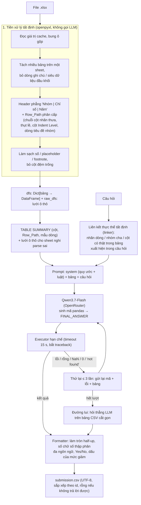

# AI Tài Năng 2026 – Hỏi đáp trên bảng Excel (Table-QA)

Hệ thống trả lời câu hỏi trên file Excel phân cấp (header nhiều tầng, ô gộp, nhiều bảng trên một sheet) bằng **tiền xử lý tất định + sinh mã Python/pandas bằng LLM (Qwen3.7-Flash qua OpenRouter) + tự sửa lỗi**. Đội thi **AI26C0062**, Vòng Khu vực – Bảng C. Chạy bằng Docker, nhận đúng 6 tham số của BTC (xem §6).

**Kết quả nhanh** (Qwen3.7-Flash, reasoning tắt, 3 lần chạy mỗi bộ): bộ công khai `p2` ≈ 28–30/30, `p4` ≈ 19–20/20; bộ ngoài RealHiTBench không dùng để chỉnh (`p6`, bảng test) ≈ 48–51%. Chi tiết và cách đọc con số ở §4.

---

## 1. Kiến trúc



CLI (`app/cli.py`) chạy các câu hỏi song song bằng `multiprocessing` (mặc định 5 tiến trình), có deadline 35 phút để luôn ghi được CSV, gọi OpenRouter với thử lại theo `Retry-After`/backoff mũ cho 429/5xx/402 tạm thời, thống kê token và chi phí.

### Các thành phần (`app/services/`)

| Module | Vai trò |
| :--- | :--- |
| `preprocessor.py` | Parse workbook: tách bảng, dò header/dữ liệu/cột nhãn, dựng `Row_Path`, làm sạch giá trị, `generate_table_summary`, `suspicious_sheets`, `raw_grid_preview`, `parse_raw_workbook` |
| `linker.py` | Liên kết thực thể: liệt kê nhãn dòng, nhóm cha, tổ hợp `BEST ROW`, cột và gợi ý "average across all" xuất hiện trong câu hỏi (đa ngôn ngữ, bỏ "s" số nhiều) |
| `pipeline.py` | Prompt hệ thống (quy ước + luật), vòng sinh mã – thực thi – thử lại, đường lui |
| `executor.py` | Thực thi mã trong namespace hạn chế, `SIGALRM` timeout, trả `(kết quả, traceback, stdout)` |
| `formatter.py` | Chuẩn hoá đáp án theo yêu cầu trong câu hỏi |
| `llm_client.py` | Client OpenRouter: retry, Retry-After, đếm token/chi phí, tắt reasoning |
| `layout.py` | *Thử nghiệm, tắt mặc định* (`LAYOUT_REPAIR`): LLM suy layout cho sheet nghi parse sai |

---

## 2. Phương pháp đã áp dụng và nguồn

| Phương pháp | Cài đặt | Nguồn |
| :--- | :--- | :--- |
| **Biểu diễn phân cấp kép**: header nhiều tầng nối thành `A \| B \| C`, nhãn dòng thành `Row_Path` (≈ cây header/dòng) | `preprocessor.py` | HiTab – [arXiv:2108.06712](https://arxiv.org/abs/2108.06712); TreeThinker trong RealHiTBench – [arXiv:2506.13405](https://arxiv.org/abs/2506.13405); HO-Tree của ST-Raptor – [arXiv:2508.18190](https://arxiv.org/abs/2508.18190) |
| **Tiền xử lý tất định thay vì đưa bảng thô cho LLM** (LLM tụt 10–15% trên bảng phân cấp, ≤ 70% khi nhận diện ô gộp) | bung ô gộp, đọc cache formula, bỏ footnote/ghi chú | TableEval – [ACL Anthology](https://aclanthology.org/2025.emnlp-main.363.pdf) |
| **Neo cấu trúc / nén ngữ cảnh**: chỉ đưa danh mục cột, `Row_Path`, vài dòng mẫu | `generate_table_summary` | SpreadsheetLLM – [arXiv:2407.09025](https://arxiv.org/abs/2407.09025) |
| **Chọn lược đồ / liên kết thực thể** (nhãn dòng, cột có thật trong câu hỏi) | `linker.py` | CHESS – [arXiv:2405.16755](https://arxiv.org/abs/2405.16755); TableZoomer – [arXiv:2509.01312](https://arxiv.org/abs/2509.01312); DIN-SQL – [arXiv:2304.11015](https://arxiv.org/abs/2304.11015) |
| **Program-aided**: LLM chỉ viết mã, phép tính do Python thực hiện | `pipeline.py`, `executor.py` | PAL – [arXiv:2211.10435](https://arxiv.org/abs/2211.10435); Program of Thoughts – [arXiv:2211.12588](https://arxiv.org/abs/2211.12588); Text-to-pandas ở SemEval-2025 Task 8 – [sonrobok4](https://preview.aclanthology.org/setup/2025.semeval-1.51), [IUST_Champs](https://preview.aclanthology.org/setup/2025.semeval-1.260) |
| **Tự sửa lỗi theo traceback / kết quả rỗng** | vòng thử lại ≤ 3, kèm bảng và lưới thô | Self-Debug – [arXiv:2304.05128](https://arxiv.org/abs/2304.05128); InterCode – [arXiv:2306.14898](https://arxiv.org/abs/2306.14898); PoTable – [arXiv:2412.04272](https://arxiv.org/abs/2412.04272) |
| **Đường lui trả lời trực tiếp** khi mã thất bại | `direct_answer` | ReAcTable – [arXiv:2310.00815](https://arxiv.org/abs/2310.00815) |
| **Luật prompt theo quy ước của đề**: "average across all" trên mọi cột kể cả Total (FAQ BTC); tuổi tính tại ngày nhập học; hướng giảm/tăng; không nhân theo ghi chú đơn vị; đếm thực thể lá; không tự làm tròn | `SYSTEM_PROMPT` | FAQ/đề thi (`GIAI_DAP_THAC_MAC.md`), p4_q001/q002 |

Các bài đã đọc và **chưa áp dụng** (kèm lý do ở §5): Table Meets LLM ([arXiv:2305.13062](https://arxiv.org/abs/2305.13062)), TableMaster ([arXiv:2501.19378](https://arxiv.org/abs/2501.19378)), Orchestra ([arXiv:2601.03137](https://arxiv.org/abs/2601.03137)), Chain-of-Table ([arXiv:2401.04398](https://arxiv.org/abs/2401.04398)), SQuARE ([arXiv:2512.04292](https://arxiv.org/abs/2512.04292)).

---

## 3. Quy ước đã xác nhận / suy ra

- "average across all …" không chỉ định cấp → trung bình trên **mọi cột** có mặt, kể cả Total (FAQ Câu 01).
- Tuổi / oldest / youngest khi có ngày sinh và ngày nhập học → tính **tại ngày nhập học** (suy ra từ `p4_q001`, `p4_q002`).
- BTC chuẩn hoá chữ thường, khoảng trắng, dấu thừa, dấu thập phân khi so khớp; câu hỏi luôn nêu rõ định dạng (FAQ Câu 04).
- `id` là số tự nhiên, CSV UTF-8 sắp theo `id`, câu không trả lời để rỗng; chỉ `.xlsx`, nhiều sheet, nhiều ngôn ngữ; disk 1 GB, RAM tối đa 4 GB; token tính = input + reasoning.

---

## 4. Kết quả

Mọi số liệu dùng `qwen/qwen3.7-flash`, reasoning tắt, trong Docker; Qwen không hoàn toàn xác định nên điểm dao động giữa các lần chạy (±1–2 câu ở bộ nhỏ, tới ±4–7 câu ở bộ 130–200 câu).

### 4.1. Bộ công khai của đề (dùng để phát triển)

| Bộ | Điểm (3 lần chạy) | Ghi chú |
| :--- | :-: | :--- |
| `data/p2` (30 câu, id số, đa ngôn ngữ) | 28,3 – 29,7 / 30 | lần chạy cuối trong Docker từ zip: **30/30** |
| `data/p4` (20 câu) | 18,7 – 20 / 20 | lần chạy cuối trong Docker từ zip: 18/20 |

~40 s cho 30 câu với 5 tiến trình, ~4,2k token/câu, ~$0,006 mỗi lượt 30 câu; RAM đỉnh ~280 MB. Tập ẩn 20 câu ước dưới 2 phút (giới hạn 40 phút).

### 4.2. Nguồn dữ liệu công khai và bộ đánh giá ngoài

`p2_t01–t06` và `p4_t02–t10` là các bảng của **RealHiTBench** ([arXiv:2506.13405](https://arxiv.org/abs/2506.13405), [dữ liệu](https://huggingface.co/datasets/spzy/RealHiTBench), đã xác minh bằng nội dung ô); câu hỏi do BTC viết lại. `p2_t11–t15` là bảng Statistics Canada (nguồn của [HiTab](https://github.com/microsoft/hitab)); `p2_t09–t10` là bảng tài chính SEC.

Để đo khả năng tổng quát hoá, dựng các bộ ngoài từ RealHiTBench bằng `scripts/build_external_set.py` (CC BY-NC 4.0, chỉ dùng cục bộ, không đưa vào gói nộp). 707 bảng được chia cố định theo hash tên file: **dev 513 bảng** (được xem lỗi) và **test 194 bảng** (chỉ xem số tổng hợp):

| Bộ | Nguồn bảng | Số câu | Điểm (3 lần) |
| :--- | :--- | :-: | :-: |
| `p5` | hỗn hợp | 50 | ≈ 26 (52%) |
| `p7` | dev | 200 | 110 – 113 (55–56%) |
| `p6` | **test, chưa từng dùng để chỉnh** | 131 | 63 – 66 (48–51%) |

Đáp án gốc RealHiTBench do LLM gán nên nhiễu: đọc thủ công mẫu các câu sai nhất quán trên bảng parse tốt cho thấy ~40% đáp án gốc sai/mơ hồ, ~30% chỉ khác định dạng, ~30% lỗi thật của model; trần EM thực tế ước **65–70%**. Điểm ngoài không so trực tiếp với điểm p2/p4.

### 4.3. Chất lượng parse trên 707 bảng (`scripts/parse_metrics.py`, không cần đáp án, không gọi LLM)

Chỉ số: phủ ô số, ô dư, tên cột chứa dữ liệu, tỷ lệ cột không tên, tỷ lệ dòng không có nhãn. Bảng "ok" khi đạt hết.

| Bước cải tiến | dev ok | test ok |
| :--- | :-: | :-: |
| Ban đầu | 62,2% | 60,3% |
| + bỏ cột đệm trống không tên | 69,8% | 64,4% |
| + cắt dòng siêu dữ liệu/ghi chú đầu khối header | 73,9% | 70,1% |
| + chuỗi cột nhãn thưa hợp nhất, điền xuống ô thưa | **75,6%** | **73,7%** |

Mỗi thay đổi parser đều được kiểm tra bằng so snapshot `Row_Path` + tên cột của toàn bộ file công khai trước/sau (bắt được hai hồi quy ở `p2_t02`, `p2_t08`). Chất lượng parse giải thích ít khoảng cách EM: bảng "ok" EM 53,0% (n=257), "không ok" 48,6% (n=74).

### 4.4. Quy trình kiểm thử

1. Phần tất định (parser, linker, formatter): so snapshot trên toàn bộ file công khai + `parse_metrics.py` trên 707 bảng (vài chục giây, không nhiễu).
2. Phần LLM/prompt: `scripts/bench.py --runs 3 --sets p2,p4,p6,p7 --lenient` (24–32 tiến trình khi đo), `scripts/rescore.py` chấm lại file cũ, `scripts/triage_failures.py` phân loại câu sai.
3. Chỉ giữ thay đổi khi sửa một nguyên nhân đã xác nhận **và** không hồi quy trên tập test (`p6`); chênh lệch trong nhiễu thì gỡ.

---

## 5. Thí nghiệm đã làm và quyết định

| Thí nghiệm | Kết quả | Quyết định |
| :--- | :--- | :--- |
| Tắt reasoning của Qwen | 1,7 s thay vì 20 s mỗi lệnh gọi, ~80 thay vì ~1500 token; với reasoning bật, câu khó hết `max_tokens` và trả rỗng | **Giữ tắt** |
| Chạy song song theo tiến trình | 478 s → ~45 s cho 30 câu | **Giữ** |
| Sửa tiền xử lý theo lỗi thật (số dạng chuỗi, placeholder, thụt lề, năm ở header, khối mã cột…) | p2: 18/30 → ~27/30 | **Giữ** |
| Liên kết thực thể tất định (`linker.py`) | p2 24–28 → 29–30/30 | **Giữ** |
| Half-up thay vì làm tròn nhị phân; không tự làm tròn trong mã; nhận số chữ số thập phân đa ngôn ngữ | sửa các ca `97,725 → 97,73`, `4,125 → 4,13` | **Giữ** |
| Luật xếp hạng, đơn vị, đếm thực thể lá, dấu dương cho "decrease in" | câu "How many": 60,3% → 68,3% trên 42 câu (dev và test cùng chiều) | **Giữ** |
| Thử lại khi đáp án là `0` / "not found" + prompt thử lại kèm bảng | p5 ~18 → ~21/50 | **Giữ** |
| Lưới ô thô cho sheet nghi parse sai (12/50 câu p5, 1/20 p4, 0/30 p2) | cải thiện nhẹ, là biện pháp tạm | **Giữ, chỉ cho sheet bị gắn cờ** |
| Câu hỏi đặt trước bảng; kế hoạch bằng chú thích trước mã (Table Meets LLM, TableMaster) | trong nhiễu (p5 26,0 / 27,0 so với 26,3) | Tắt (`PROMPT_VARIANT`) |
| LLM suy layout rồi dựng lại bảng (kiểu ST-Raptor/TreeThinker) | p4 17,7 so với 19,3, làm hỏng bảng vốn đúng | Tắt (`LAYOUT_REPAIR`) |
| Luật "câu hai vế trả `label, value`" | giảm 5 điểm phần trăm trên tập test (câu "Which country" trả về số) | **Đã gỡ** |
| Bảng con theo câu hỏi (`focused_view`): Keyword-Header Tree của TreeThinker ([arXiv:2506.13405](https://arxiv.org/abs/2506.13405)) + Informer của SheetAgent ([arXiv:2403.03636](https://arxiv.org/abs/2403.03636)), làm tất định, in giá trị thật của dòng/cột khớp câu hỏi (327/381 câu có view, ~1,5K ký tự) | bật so với tắt, chạy song song, 3 lần: p6 65,0 / 66,7; p7 108,3 / 112,7; p2 28,3 / 29,7; p4 19,0 / 19,0. Trước đó `scripts/size_vs_error.py` cho thấy tỷ lệ sai p6+p7 gần như không đổi theo số dòng/cột/độ dài summary (~0,45–0,5), tức thiếu ngữ cảnh không phải nút thắt; khi có view model hay bám vào bảng con (trả giá trị thay vì nhãn, bỏ dòng ngoài view) | Tắt (`FOCUS_VIEW`) |
| Biểu quyết thích ứng 2–3 mẫu (self-consistency); `seed`; gắn nhãn `[subtotal]`; luật "ROW LOOKUP ORDER"; ghi chú đơn vị trong summary | không tăng EM hoặc làm tệ hơn | **Đã gỡ** |

---

## 6. Chạy và đóng gói (chỉ dùng Docker)

Chi tiết quy cách nộp và checklist: [`HUONG_DAN_NOP_BAI.md`](HUONG_DAN_NOP_BAI.md); đề: [`DE_THI.md`](DE_THI.md); FAQ của BTC: [`GIAI_DAP_THAC_MAC.md`](GIAI_DAP_THAC_MAC.md).

```bash
docker build --platform linux/amd64 -t ai2026-tableqa .
docker run --rm --memory 4g -v "$PWD/data/p2:/data:ro" -v "$PWD/output:/output" ai2026-tableqa \
  --xlsx-dir /data/xlsx_files --queries /data/queries.json --output /output/submission.csv \
  --openrouter-key <key> --openrouter-model qwen/qwen3.7-flash --openrouter-base-url https://openrouter.ai/api/v1
```

- Phát triển: sao chép `.env.example` thành `.env` (không đưa vào image/ZIP). Mount repo vào `/app` để chạy `scripts/*` (image không chứa `data/`):
  `docker run --rm --env-file .env -v "$PWD:/app" -w /app -e PYTHONPATH=/app --entrypoint python ai2026-tableqa scripts/bench.py --runs 3 --sets p2,p4 --lenient`
- Kiểm tra định dạng: `scripts/validate_submission.py --queries … --submission … --truth …`; xem một câu: `scripts/debug_query.py --data data/p2 --id 13`.
- Đóng gói: `scripts/package_submission.py` tạo `dist/AI26C0062.zip` (Dockerfile ở gốc, không chứa `.env`, ≤ 100 MB).

### Cấu trúc thư mục

```
round-1/
├── main.py                    # ENTRYPOINT của Docker, gọi app.cli
├── app/
│   ├── cli.py config.py       # CLI chấm thi (6 tham số, song song, deadline) và cấu hình
│   ├── main.py routers/ …     # FastAPI tuỳ chọn, không dùng khi chấm
│   └── services/              # preprocessor, linker, pipeline, executor, formatter, llm_client, layout
├── scripts/                   # bench, rescore, triage_failures, parse_metrics, build_external_set,
│                              # debug_query, validate_submission, package_submission
├── data/p2 data/p4            # bộ công khai của đề (p5/p6/p7 và data/external: cục bộ, ngoài git)
├── Dockerfile  docker-compose.yml  requirements.txt  .env.example
└── DE_THI.md  GIAI_DAP_THAC_MAC.md  HUONG_DAN_NOP_BAI.md
```

---

## 7. Vấn đề còn mở (Open Issues)

1. **Nhiễu giữa các lần chạy.** Qwen không xác định hoàn toàn (nhà cung cấp duy nhất); bộ nhỏ dao động ±1–2 câu, bộ 130–200 câu tới ±4–7. Chưa có cách rẻ nào chứng minh giảm được (biểu quyết, `seed` đã thử và gỡ). Mọi kết luận phải dựa trên nhiều lần chạy và tập test tách riêng.
2. **Đuôi dài của bố cục bảng.** Khoảng 25% bảng RealHiTBench vẫn không đạt chỉ số parse: bảng chữ không có hàng tiêu đề thật, sheet nhiều bảng bị tách quá nhỏ, nhãn dòng rỗng ở bảng ma trận. Parse chỉ giải thích một phần nhỏ khoảng cách EM nên ưu tiên thấp; chưa có luật tổng quát an toàn.
3. **Lưới ô thô chỉ là biện pháp tạm** và bộ dò sheet nghi ngờ còn thô (bắt 12/50 bảng p5; bỏ sót nhiều bảng sai).
4. **Nhóm lỗi thật còn lại của model** ở mức vài phần trăm: đếm có điều kiện lệch 1–2 đơn vị, danh sách trả về rỗng/thiếu phần tử, dấu của "difference", câu nhiều vế. Đã thử luật hai vế và gỡ vì hại câu một vế.
5. **Đáp án gốc của bộ ngoài nhiễu** nên không tách được hoàn toàn lỗi thật; trần ước 65–70%. Không nên ép điểm ngoài lên cao bằng cách khớp quy ước riêng của bộ đó.
6. **Chưa thử trên tập ẩn thật** và chưa có template của BTC để đối chiếu; một số quy ước là suy luận từ 2 câu (tuổi tại ngày nhập học).
7. **Liên kết thực thể** dựa vào nhãn xuất hiện nguyên văn (có bỏ "s" số nhiều); câu hỏi diễn đạt khác nhiều sẽ không được liên kết, khi đó model chỉ còn bảng tóm tắt.
