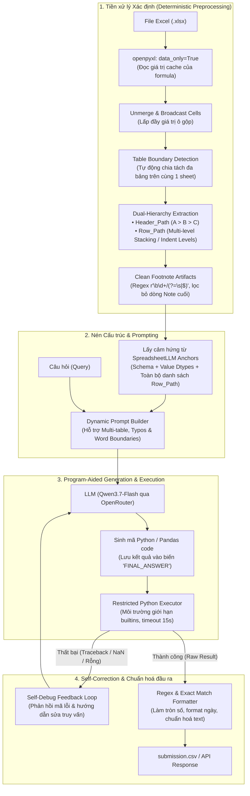

# AI Tài Năng 2026 - Chủ đề 2: Hỏi đáp trên Bảng tính Excel (Table-QA)

Hệ thống hỏi đáp tự động trên bảng tính Excel phân cấp, đa tầng, có ô gộp và đa bảng được xây dựng theo kiến trúc **FastAPI Bigger Applications** và phương pháp kết hợp **Deterministic Preprocessing + Program-Aided Table-QA (Code Generation & Execution with Self-Correction)**.

---

## 1. Kiến trúc Hệ thống & Luồng xử lý (Architecture & Data Flow)



---

## 2. Nền tảng Lý thuyết & Nguồn Paper tương ứng trong Code

Mỗi module trong codebase được thiết kế dựa trên các bài báo khoa học và công trình nghiên cứu hàng đầu về Xử lý Bảng tính và LLM:

### 2.1. Dual-Hierarchy Representation (Biểu diễn phân cấp kép)
* **Nguồn Paper:** *HiTab: A Hierarchical Table Dataset for Question Answering and Natural Language Generation* (ACL 2022 - Microsoft Research). [arXiv:2108.06712](https://arxiv.org/abs/2108.06712)
* **Vấn đề giải quyết:** Bảng tính thực tế luôn có header nhiều tầng (2–4 dòng) và nhãn dòng phân cấp thụt đầu dòng (indentation) hoặc nhóm phân tầng. Nếu chỉ đọc thô, các dòng con sẽ bị trùng lặp tên (ví dụ: các dòng tuổi `16 to 19 years` lặp lại ở cả nhóm Total, Men và Women).
* **Áp dụng trong Code ([`app/services/preprocessor.py`](file:///c:/Users/Foggo/Documents/Dev%20projects/ai-tai-nang-2026/round-1/app/services/preprocessor.py)):**
  - **Header Flattening:** Nối các tầng header thành chuỗi duy nhất: `Category | Metric | Year`.
  - **Multi-Level Row Stacking:** 
    - Nhận diện cột `Indent Level` (nếu có) để dựng cây cha - con theo cấp bậc thụt lề bằng cấu trúc stack.
    - Nhận diện các nhóm cha nhân khẩu học (`..., 16 years and over`, các nhóm chủng tộc, tình trạng hôn nhân) dù dòng đó có chứa dữ liệu số, tạo nên tọa độ hàng hoàn chỉnh: `Section | Sub_Section | Item` (ví dụ: `AGE AND SEX | Men, 16 years and over | 16 to 19 years`).
  - **Kết quả thực nghiệm:** Tỷ lệ dòng trùng `Row_Path` giảm từ 32–66 dòng/bảng xuống **0 dòng trùng lặp (100% Unique)** trên toàn bộ tập dữ liệu mẫu.

### 2.2. Deterministic Preprocessing vs. End-to-End LLM
* **Nguồn Paper:** *TableEval: A Real-World Benchmark for Complex, Multilingual, and Multi-Structured Table QA* (ACL Anthology 2025). [ACL Anthology](https://aclanthology.org/2025.emnlp-main.363.pdf)
* **Vấn đề giải quyết:** Nghiên cứu TableEval chỉ ra các LLM hàng đầu (như o1-preview, Claude 3.5 Sonnet) đều tụt 10–15% độ chính xác trên bảng phân cấp và **không mô hình nào vượt quá 70% độ chính xác khi nhận diện ô gộp (merged cells)** nếu đưa bảng thô vào prompt.
* **Áp dụng trong Code ([`app/services/preprocessor.py`](file:///c:/Users/Foggo/Documents/Dev%20projects/ai-tai-nang-2026/round-1/app/services/preprocessor.py)):**
  - Không để LLM tự đoán ô gộp. Toàn bộ logic unmerge, đọc formula cache (`data_only=True`), và loại bỏ footnote `(1)`, `\b\d+/(?=\s|$)` được xử lý xác định bằng mã lệnh Python thuần với `openpyxl` trước khi đưa dữ liệu vào LLM.

### 2.3. Tách Đa Bảng trên cùng 1 Sheet (Multi-Table Partitioning)
* **Vấn đề giải quyết:** Các bảng dữ liệu (như `p4_t02.xlsx`) thường xếp chồng nhiều bảng độc lập trên cùng một trang tính (ví dụ bảng `Fiscal years` xếp trên bảng `Calendar years`, ngăn cách bởi khoảng trống và tiêu đề mới).
* **Áp dụng trong Code ([`app/services/preprocessor.py`](file:///c:/Users/Foggo/Documents/Dev%20projects/ai-tai-nang-2026/round-1/app/services/preprocessor.py) -> `detect_table_ranges()`):**
  - Thuật toán phân tích cấu trúc phát hiện biên giới bảng độc lập, tự động phân rã worksheet thành các DataFrames riêng biệt (`Monsumtable - Fiscal years` và `Monsumtable - Calendar years`).

### 2.4. Structural Anchors (Lấy cảm hứng từ ý tưởng nén của SpreadsheetLLM)
* **Nguồn Paper:** *SpreadsheetLLM: Encoding Spreadsheets for Large Language Models* (EMNLP 2024 - Microsoft Research). [arXiv:2407.09025](https://arxiv.org/abs/2407.09025)
* **Áp dụng trong Code ([`app/services/preprocessor.py`](file:///c:/Users/Foggo/Documents/Dev%20projects/ai-tai-nang-2026/round-1/app/services/preprocessor.py) -> `generate_table_summary()`):**
  - Thay vì đưa toàn bộ cell thô gây tốn token và vượt context, hệ thống cung cấp danh mục cột (`Columns`), danh mục toàn bộ các nhãn hàng hợp lệ (`Available Row_Paths` lên đến 150 dòng bao quát toàn bộ bảng dài như `p4_t07`), và mẫu dữ liệu đại diện. Điều này giúp LLM định vị chính xác chuỗi cần truy vấn mà không phải đoán mò.

### 2.5. Program-Aided Table-QA (Code Generation & Execution)
* **Nguồn Paper:**
  - *PAL: Program-aided Language Models* (ICML 2023 - Carnegie Mellon University). [arXiv:2211.10435](https://arxiv.org/abs/2211.10435)
  - *Program of Thoughts Prompting* (TMLR 2023). [arXiv:2211.12588](https://arxiv.org/abs/2211.12588)
* **Vấn đề giải quyết:** LLM có khả năng hiểu ngữ nghĩa ngôn ngữ tự nhiên tốt nhưng tính toán số học rất dễ sinh ảo giác (hallucination).
* **Áp dụng trong Code ([`app/services/pipeline.py`](file:///c:/Users/Foggo/Documents/Dev%20projects/ai-tai-nang-2026/round-1/app/services/pipeline.py) & [`app/services/executor.py`](file:///c:/Users/Foggo/Documents/Dev%20projects/ai-tai-nang-2026/round-1/app/services/executor.py)):**
  - LLM chỉ sinh code logic truy vấn bằng Python (`pandas`) dựa trên các mẫu lập trình trừu tượng (abstract patterns).
  - Quá trình tính toán thực tế được thực thi trong môi trường `Restricted Python Executor`, đảm bảo độ chính xác tính toán tuyệt đối.

### 2.6. Hướng tiếp cận Text-to-Pandas
* **Nguồn Tham khảo:** *SemEval-2025 Task 8: Question Answering over Tabular Data (DataBench)*. Nhiều đội nhóm đạt thứ hạng cao (như sonrobok4 - [SemEval 2025](https://preview.aclanthology.org/setup/2025.semeval-1.51) và IUST_Champs - [SemEval 2025](https://preview.aclanthology.org/setup/2025.semeval-1.260)) đã chứng minh tính hiệu quả vượt trội của việc chuyển đổi câu hỏi tự nhiên thành mã xử lý dữ liệu Python (Text-to-Python/Pandas) kết hợp lọc metadata cấu trúc. Pandas tỏ ra linh hoạt hơn SQL khi xử lý chuỗi phân cấp, regex, chuyển đổi kiểu dữ liệu tức thời và thao tác trên bảng bán cấu trúc.

### 2.7. Traceback-driven Self-Correction (Vòng lặp tự sửa lỗi)
* **Nguồn Paper:**
  - *Self-Debug: Teaching Large Language Models to Self-Debug* (ICLR 2024 - Chen et al.). [arXiv:2304.05128](https://arxiv.org/abs/2304.05128)
  - *InterCode: Standardizing and Benchmarking Interactive Coding with Execution Feedback* (NeurIPS 2023 - Yang et al.). [arXiv:2306.14898](https://arxiv.org/abs/2306.14898)
* **Áp dụng trong Code ([`app/services/pipeline.py`](file:///c:/Users/Foggo/Documents/Dev%20projects/ai-tai-nang-2026/round-1/app/services/pipeline.py)):**
  - Hàm `is_invalid_result()` theo dõi không chỉ các exception (Traceback) mà còn bắt các trường hợp tính ra `NaN`, `None` hoặc chuỗi rỗng để kích hoạt feedback loop gửi lại cho LLM sửa mã truy vấn.

### 2.7b. Tài liệu tham khảo bổ sung (đã đọc để tìm hướng giảm nhiễu / sai cấu trúc)
| Paper | Ý chính liên quan | Kết luận cho dự án |
| :--- | :--- | :--- |
| *ReAcTable: Enhancing ReAct for Table QA* (VLDB 2024) – [arXiv:2310.00815](https://arxiv.org/abs/2310.00815) | Sinh nhiều ứng viên ở mỗi bước và chọn bằng **kết quả thực thi** (execution-based voting) thay vì biểu quyết cả chuỗi | Tương đương biểu quyết đã thử (không tăng EM, gấp đôi token) → chưa áp dụng |
| *Accurate Table QA with Accessible LLMs* (Orchestra) – [arXiv:2601.03137](https://arxiv.org/abs/2601.03137) | Với model nhỏ, chia việc thành nhiều agent, mỗi agent một tác vụ đơn giản thay vì một prompt dài | Gợi ý nếu cần nâng tiếp: tách bước chọn dòng/cột khỏi bước sinh code (hiện đã làm một phần bằng linker tất định) |
| *PoTable: Plan-then-Execute Stage Reasoning on Tables* – [arXiv:2412.04272](https://arxiv.org/abs/2412.04272) | Lỗi thực thi được đưa lại cho LLM để sinh lại | Giống vòng self-correction hiện có |
| *Interpretable LLM-based Table QA* (POS) – [arXiv:2412.12386](https://arxiv.org/abs/2412.12386) | Chương trình tất định, chỉ ~4 lệnh gọi LLM/câu (so với Binder 50, DATER 100) | Phù hợp ràng buộc token/chi phí của cuộc thi |
| *Chain-of-Table* (ICLR 2024) – [arXiv:2401.04398](https://arxiv.org/abs/2401.04398) | Bảng được biến đổi dần như chuỗi suy luận | Pandas code đã đóng vai trò tương tự |
| *ST-Raptor: LLM-Powered Semi-Structured Table QA* – [arXiv:2508.18190](https://arxiv.org/abs/2508.18190) | Cây bố cục phân cấp (Hierarchical Orthogonal Tree) cho bảng Excel nhiều cấp | Cùng hướng với `Row_Path` / flatten header; tham khảo cho open issue #3 |
| *SQuARE: hybrid retrieval cho bảng tính* – [arXiv:2512.04292](https://arxiv.org/abs/2512.04292) | Đo độ phức tạp cấu trúc sheet (độ sâu header, ô gộp) để định tuyến | Tham khảo, chưa cần (tập ẩn ≤ 20 câu) |
| *SMART: Semantic Header Flattening and Pseudo-Code-Style Reasoning* (ACL Findings 2026) – [ACL Anthology](https://aclanthology.org/2026.findings-acl.1474/) | Làm phẳng header nhiều cấp thay vì để LLM tự suy ra phân cấp | Khớp với cách làm hiện tại (header ghép bằng ` \| `) |
| *HiTab* – [arXiv:2108.06712](https://arxiv.org/abs/2108.06712) | Bảng phân cấp | Đã dùng ở §2.1 |

### 2.7c. Bằng chứng SOTA cho bảng phân cấp / bán cấu trúc và hệ quả thiết kế
| Nguồn | Phát hiện có số liệu | Hệ quả cho dự án |
| :--- | :--- | :--- |
| *ST-Raptor: LLM-Powered Semi-Structured Table QA* – [arXiv:2508.18190](https://arxiv.org/abs/2508.18190) | Ablation trên SSTQA: bỏ bước chuyển bảng thành cây (HO-Tree) giảm **15,15 điểm** (72,39% → 57,24%), nhiều hơn bỏ thao tác dữ liệu (−7,30), bỏ kiểm chứng đáp án (−6,29), bỏ phân rã câu hỏi (−4,33). Cây nhận diện header bằng VLM + embedding, hỗ trợ trực tiếp Excel | **Biểu diễn cấu trúc là đòn bẩy lớn nhất**, lớn hơn mọi mẹo prompt; ưu tiên tiền xử lý |
| *RealHiTBench* (ACL 2025 Findings) – [arXiv:2506.13405](https://arxiv.org/abs/2506.13405) | TreeThinker: bỏ bước sinh cây header giảm **~8 điểm** (GPT-4o 63,29 → 55,27), bỏ bước suy luận theo cây chỉ giảm ~2,5. Đầu vào văn bản (LaTeX) hơn ảnh 10–15 điểm; bảng > 20k token chỉ còn ~31% | Header phải được dựng thành cây cấp bậc (tuple loại/cấp/vị trí đầu–cuối/nội dung) **trước** khi hỏi; giữ bảng gọn; không dùng ảnh |
| *SpreadsheetLLM* – [arXiv:2407.09025](https://arxiv.org/abs/2407.09025) | SheetCompressor (neo cấu trúc + chỉ mục ngược + gom theo định dạng số) nén ~25 lần, tăng 25,6% phát hiện bảng so với mã hoá thô | Dùng neo cấu trúc (hàng/cột ranh giới vùng) để chọn vùng cần đưa cho LLM thay vì dán cả sheet |
| *TableMaster* (ICLR 2026) – [arXiv:2501.19378](https://arxiv.org/abs/2501.19378) | Table-of-focus, verbalization, chuẩn hoá bảng, lập luận thích ứng giữa văn bản và code; 78,13% WikiTQ (GPT-4o-mini) | Chuẩn hoá bảng trước khi hỏi là một thành phần chính |
| *HiTab* (ACL 2022) – [arXiv:2108.06712](https://arxiv.org/abs/2108.06712) | 78% bảng có header cột nhiều cấp, 86% có header dòng nhiều cấp; cây phân cấp trích bằng heuristic trên ô gộp/định dạng, đúng 94% trên 100 bảng mẫu | Heuristic tất định trên ô gộp, thụt lề và định dạng đã đủ cho phần lớn bảng; chỉ bảng còn lại cần LLM |

**Kết luận:** các bài trên xác nhận hướng đã áp dụng ở §2.1–2.7 (cây header ≈ `Row_Path` + header ghép ` | `, neo cấu trúc, program-aided, tự sửa lỗi), không phải hướng mới. Phần chưa áp dụng nằm ở *cách trình bày prompt* (xem §2.7d). Cách dán lưới ô thô vào prompt chỉ là biện pháp tạm.

### 2.7d. Tối ưu prompt: bằng chứng và những gì chưa áp dụng
| Kỹ thuật | Bằng chứng | Hiện trạng |
| :--- | :--- | :--- |
| Câu hỏi đặt **trước** bảng | *Table Meets LLM* ([arXiv:2305.13062](https://arxiv.org/abs/2305.13062), WSDM 2024): đặt sau bảng giảm ~6,8 điểm | Chưa: câu hỏi đang ở cuối prompt |
| Ví dụ mẫu one-shot | Cùng paper: bỏ ví dụ giảm mạnh nhất (~30% ở zero-shot) | Chỉ có 3 mẫu mã ngắn, chưa có ví dụ trọn vẹn (bảng → code → đáp án) |
| Lập luận bằng văn bản trước khi viết code | *TableMaster* ([arXiv:2501.19378](https://arxiv.org/abs/2501.19378)): bỏ textual reasoning −4,28, bỏ textual guidance −2,92 (WikiTQ) | Chưa: model viết code ngay |
| Table-of-focus + table peek | TableMaster: bỏ table-of-focus −1,73, bỏ structure extraction −3,38; giảm kích thước ngữ cảnh | Một phần: summary liệt kê toàn bộ cột/`Row_Path`, chưa lọc theo câu hỏi |
| Tự bổ sung giá trị/khoảng quan trọng (self-augmentation) | Table Meets LLM: +0,8 đến +5,7 điểm | Tương đương `ENTITY LINKS` (đã giữ, +5 điểm trên p2) |
| Định dạng bảng đưa vào prompt | Table Meets LLM: HTML tốt nhất ở 4/5 tập; Markdown yếu ở truy xuất cột (35,3%); RealHiTBench: văn bản hơn ảnh 10–15 điểm | Dùng danh sách cột + mẫu dòng, không đưa nội dung bảng nguyên văn (giữ token thấp) |

### 2.8. So sánh & Phân tích các hướng tiếp cận khác
| Phương pháp | Phân tích tính tương thích với bài toán |
| :--- | :--- |
| **Text2SQL thuần (DIN-SQL [arXiv:2304.11015](https://arxiv.org/abs/2304.11015), NeurIPS 2023 / CHESS [arXiv:2405.16755](https://arxiv.org/abs/2405.16755))** | Giả định schema quan hệ sạch đạt chuẩn 1NF/2NF. Khi gặp bảng Excel có chú thích, footnote, dòng trống, nhãn lồng nhau, Text2SQL sinh câu lệnh SQL sai cú pháp hoặc trả về tập rỗng do thiếu schema quan hệ chuẩn hoá. |
| **MaskSQL ([arXiv:2509.23459](https://arxiv.org/abs/2509.23459))** | Là công trình nghiên cứu về **bảo vệ quyền riêng tư dữ liệu (Privacy-preserving Text-to-SQL)**, sử dụng cơ chế xáo trộn/che giấu (masking/perturbation) tên bảng, cột và giá trị tế nhị trước khi gửi sang LLM từ xa để tránh lộ bí mật dữ liệu. Paper cho thấy cơ chế bảo mật này làm tăng ~4.5 lần chi phí token và suy giảm 13–20 điểm accuracy do giảm sút thông tin ngữ cảnh. Phương pháp này không phù hợp với bài toán tối ưu độ chính xác và tài nguyên của Vòng 1. |

---

## 3. Khả năng Tổng quát hoá & Xử lý Trường hợp Biên (Edge Cases)

Hệ thống được thiết kế hướng tới tập dữ liệu ẩn thực tế:

1. **Workbook nhiều sheet & nhiều bảng trên 1 sheet:**
   - `preprocessor.py` duyệt toàn bộ sheet và tự động tách các bảng độc lập vào `dfs: Dict[str, pd.DataFrame]`. LLM được cung cấp đầy đủ tên bảng để lựa chọn chính xác.
2. **Cột Indent Level và phân cấp nhân khẩu học:**
   - Tự động nhận diện cột thụt lề bằng số (0, 1, 2, 3...) hoặc phân tầng nhân khẩu học theo nhóm cha để bảo đảm `Row_Path` luôn mang đầy đủ ngữ cảnh phân cấp, triệt tiêu hoàn toàn hiện tượng trùng tên hàng.
3. **Phân biệt từ khóa có chứa nhau (Word Boundary Matching):**
   - Hướng dẫn LLM bắt buộc sử dụng ranh giới từ `r'\bterm\b'` (ví dụ: `r'\bmen\b'` để không khớp nhầm vào `women`).
4. **Môi trường thực thi giới hạn (Restricted Execution):**
   - Chạy với namespace builtins được kiểm soát và timeout 15 giây (SIGALRM trong container Linux) để chống lặp vô tận và bảo vệ môi trường chấm thi offline.

---

## 4. Cấu trúc Dự án (FastAPI Bigger Applications Layout)

Dự án được tổ chức theo chuẩn kiến trúc hướng module [FastAPI - Bigger Applications](https://fastapi.tiangolo.com/tutorial/bigger-applications/):

```
round-1/
├── app/
│   ├── __init__.py          # Khởi tạo app package
│   ├── main.py              # FastAPI Application (tuỳ chọn, không dùng khi chấm)
│   ├── cli.py               # CLI chấm thi: --xlsx-dir/--queries/--output/--openrouter-*
│   ├── config.py            # Quản lý Settings tập trung bằng pydantic-settings
│   ├── dependencies.py      # Dependency injection (get_qa_pipeline, get_settings)
│   ├── models/              # Pydantic Schemas định kiểu nghiêm ngặt
│   │   ├── __init__.py
│   │   └── schemas.py       # QueryItem, QueryResponse, EvaluationMetric
│   ├── services/            # Core Business Logic & Algorithms
│   │   ├── __init__.py
│   │   ├── preprocessor.py  # Thuật toán Dual-Hierarchy, Multi-table & Indent Level
│   │   ├── llm_client.py    # LLM Client OpenRouter (Qwen3.7-Flash): retry 429/5xx, thống kê token/cost
│   │   ├── executor.py      # Restricted Execution với timeout & traceback capture (PAL)
│   │   ├── formatter.py     # Rule-based Exact Match Post-processor
│   │   └── pipeline.py      # Pipeline Orchestrator với Self-Correction Loop (Self-Debug)
│   └── routers/             # REST API Endpoints mở rộng
│       ├── __init__.py
│       ├── health.py        # GET /health
│       └── qa.py            # POST /qa/ask, POST /qa/batch
├── data/
│   ├── p4/                  # Bộ công khai đợt 1 (20 câu): xlsx_files/, queries.json, sample_submission.csv
│   └── p2/                  # Bộ công khai đợt 2 (30 câu, id số): xlsx_files/, queries.json, sample_submission.csv
├── main.py                  # ENTRYPOINT của Docker image (gọi app.cli)
├── evaluate.py              # Script đánh giá Exact Match trên 20 câu mẫu (Dev Set)
├── unseen_evaluation.py     # Script đánh giá độc lập trên 25 câu hỏi Unseen (Test Set)
├── unseen_evaluation_report.json # Báo cáo chi tiết kết quả kiểm thử Unseen
├── .env.example             # File mẫu cấu hình biến môi trường an toàn
├── Dockerfile               # Image linux/amd64, ENTRYPOINT ["python", "main.py"]
├── docker-compose.yml       # Mô phỏng hệ thống chấm (/input read-only, RAM 4 GB)
├── scripts/
│   ├── validate_submission.py  # Kiểm tra định dạng submission.csv (+ Exact Match)
│   └── package_submission.py   # Đóng gói dist/<team>.zip đúng quy cách
├── HUONG_DAN_NOP_BAI.md     # Hướng dẫn nộp bài + checklist
└── requirements.txt         # Danh mục dependencies đã khóa phiên bản
```

---

## 5. Hướng dẫn Cài đặt & Sử dụng (chỉ dùng Docker)

> Quy cách nộp bài và checklist đầy đủ: [`HUONG_DAN_NOP_BAI.md`](HUONG_DAN_NOP_BAI.md).

### 5.1. Build image

```bash
docker build --platform linux/amd64 -t ai2026-tableqa .
```

### 5.2. Chạy giống hệ thống chấm

Image khai báo `ENTRYPOINT ["python", "main.py"]` và nhận đúng 6 tham số của BTC:

```bash
docker run --rm --memory 4g -v "$PWD/data/p2/xlsx_files:/input/xlsx_files:ro" -v "$PWD/data/p2/queries.json:/input/queries.json:ro" -v "$PWD/output:/output" ai2026-tableqa --xlsx-dir /input/xlsx_files --queries /input/queries.json --output /output/submission.csv --openrouter-key <key> --openrouter-model qwen/qwen3.7-flash --openrouter-base-url https://openrouter.ai/api/v1
```

Hoặc dùng compose (lấy `OPENROUTER_API_KEY` từ `.env`, kết quả ở `output/submission.csv`):

```bash
docker compose run --rm grader
```

- Chạy song song `--workers N` (mặc định 5 tiến trình); có deadline 35 phút để vẫn ghi được CSV; `submission.csv` sắp xếp theo `id` tăng dần.
- Qwen có reasoning mặc định (chậm, tốn token): pipeline tắt reasoning qua `reasoning.enabled=false` (đổi bằng biến `OPENROUTER_REASONING_EFFORT=none|low|medium|high`).
- Gặp 429/5xx/402 tạm thời: thử lại theo `Retry-After` hoặc backoff mũ; không sleep giữa các request bình thường.
- Log ghi ra **stderr**; `submission.csv` chỉ chứa `id,answer`.
- Câu hỏi lỗi → answer rỗng, chương trình vẫn ghi đủ mọi id và thoát mã 0.
- Không có API key trong mã nguồn; `.env` bị loại khỏi image (`.dockerignore`) và khỏi ZIP.

### 5.3. Cấu hình `.env` (chỉ dùng khi phát triển)

Sao chép `.env.example` thành `.env` và điền `OPENROUTER_API_KEY`. Khi chấm thi, key/model/base URL được truyền qua tham số dòng lệnh nên `.env` không cần thiết. Chạy với key lấy từ `.env`:

```bash
docker run --rm --env-file .env -v "$PWD/data/p2/xlsx_files:/input/xlsx_files:ro" -v "$PWD/data/p2/queries.json:/input/queries.json:ro" -v "$PWD/output:/output" ai2026-tableqa --xlsx-dir /input/xlsx_files --queries /input/queries.json --output /output/submission.csv
```

### 5.4. Kiểm tra kết quả & đánh giá

Image không chứa thư mục `data/` (loại bởi `.dockerignore`), nên khi đánh giá mount cả repo vào `/app`:

```bash
docker run --rm -v "$PWD:/app" -w /app -e PYTHONPATH=/app --entrypoint python ai2026-tableqa scripts/validate_submission.py --queries data/p2/queries.json --submission output/p2.csv --truth data/p2/sample_submission.csv
```

Đánh giá cả bộ (chạy N lần để thấy độ dao động của Qwen) và xem chi tiết một câu:

```bash
docker run --rm --env-file .env -v "$PWD:/app" -w /app -e PYTHONPATH=/app --entrypoint python ai2026-tableqa scripts/debug_query.py --data data/p2 --id 13
```

```bash
docker run --rm --env-file .env -v "$PWD:/app" -w /app -e PYTHONPATH=/app --entrypoint python ai2026-tableqa unseen_evaluation.py
```

### 5.5. Đóng gói bài nộp

```bash
docker run --rm -v "$PWD:/src" -w /src --entrypoint python ai2026-tableqa scripts/package_submission.py
```

Tạo `dist/AI26C0062.zip` (mã đội **AI26C0062**, tên tệp phải khớp chính xác) với `Dockerfile` ở gốc, kiểm tra không chứa `.env` và dung lượng ≤ 100 MB. Có thể nộp lại nhiều lần; bản gần nhất trước hạn được dùng để chấm.

---

## 6. Ghi nhận Thực nghiệm (Experimental Observations)

Tất cả số liệu dưới đây dùng **`qwen/qwen3.7-flash` qua OpenRouter** (model chấm thi), reasoning tắt, 5 tiến trình song song, trong Docker (`--memory 4g --cpus 6`). Đáp án lấy từ `sample_submission.csv` của từng bộ công khai.

### 6.1. Kết quả theo bộ dữ liệu công khai (cấu hình chốt)

Đo bằng `scripts/bench.py --runs 4` (mỗi lần chạy là một lượt CLI đầy đủ):

| Bộ | Điểm từng lần chạy | Trung bình | Thời gian / lần chạy | Token / lần chạy | Chi phí / lần chạy |
| :--- | :-: | :-: | :-: | :-: | :-: |
| `data/p2` (30 câu, `id` số, nhiều ngôn ngữ) | 29, 29, 27, 30 | **28,8 / 30 (96%)** | ~39 s | ~125–130k (~4,2k/câu) | ~$0,004 |
| `data/p4` (20 câu) | 20, 19, 20, 20 | **19,8 / 20 (99%)** | ~20 s | ~72–74k (~3,6k/câu) | ~$0,002 |

- **Không còn lỗi hệ thống**: không câu nào sai ≥ 2/4 lần; các câu sai còn lại là nhiễu (sai đúng một lần, thay đổi giữa các lần chạy).
- RAM đỉnh quan sát khi chạy 5 tiến trình: ~280 MB (giới hạn đề: RAM 4 GB, disk 1 GB). Thời gian ước tính cho 20 câu của tập ẩn: dưới 1 phút (giới hạn 40 phút).
- Qwen không hoàn toàn xác định dù `temperature=0` hoặc có `seed` (nhà cung cấp duy nhất là Alibaba), nên điểm dao động ±1–2 câu giữa các lần chạy. **Mọi kết luận phải dựa trên nhiều lần chạy.**

### 6.2. Các thí nghiệm đã thực hiện

| Thí nghiệm | Kết quả | Quyết định |
| :--- | :--- | :--- |
| Tắt reasoning của Qwen (`reasoning.enabled=false`) | 1,7 s thay vì 20 s mỗi lệnh gọi, ~80 token thay vì ~1500; với reasoning bật, câu hỏi phức tạp hết `max_tokens` và trả về rỗng | **Giữ tắt** |
| Chạy song song theo tiến trình (`--workers`) | 478 s → ~45 s cho 30 câu | **Giữ** |
| Sửa tiền xử lý (ô số dạng chuỗi, placeholder, thụt lề, năm ở header, nhãn `2005/2006`, khối chỉ có mã cột...) | p2: 18/30 → ~27/30; kết quả parse 13 file p4 không đổi (trừ `p4_t01`, đã sửa) | **Giữ** |
| Gắn nhãn `[subtotal]` cho cột Total + quy tắc "đọc theo nghĩa đen" (thử trên Gemini) | Làm tệ hơn (5/7 → 2–3/7): model dùng nhãn để *loại* cột Total | **Đã gỡ**; thay bằng quy ước chính thức của BTC (trung bình trên mọi cột có mặt, kể cả Total) |
| Quy tắc "ROW LOOKUP ORDER" (ưu tiên khớp chính xác nhãn dòng) | p2 trung bình ~26,3 so với ~27–28 trước đó | **Đã gỡ** |
| **Entity linking tất định** (`app/services/linker.py`): liệt kê nhãn dòng/cột có thật trong bảng xuất hiện trong câu hỏi (kể cả nhóm cha và chữ CJK) vào prompt, không thêm lệnh gọi LLM | p2 24–28/30 → **29, 29, 30/30**; p4 18–19 → 19–20; token/câu gần như không đổi | **Giữ** (nguồn: CHESS – Information Retriever / Schema Selector, [arXiv:2405.16755](https://arxiv.org/abs/2405.16755); TableZoomer – column selection + entity linking + Program-of-Thoughts, [arXiv:2509.01312](https://arxiv.org/abs/2509.01312)) |
| Mở rộng entity linking: nhóm cha khớp theo "đủ các từ", dòng `BEST ROW` (giao nhóm cha + nhãn dòng, `Row_Path` đầy đủ), gợi ý toàn bộ cột số cho "average across all" | Sửa lỗi hệ thống p2 q10 (model ghép chuỗi + regex `\|` rồi chọn nhầm dòng `TOTAL`), q11, q12; p4_q007 ổn hơn | **Giữ** |
| Nối các mảnh tiêu đề bị ngắt dòng (`Rubber,` / `plastics &` / ... → một cụm) | Tên cột khớp nguyên cụm với câu hỏi; parse p4_t02..t10 không đổi | **Giữ** |
| Quy tắc prompt: `regex=False` cho chuỗi chứa ` \| `, hướng "giảm" cho kết quả dương, nhãn cột lấy đoạn cuối | Trung hoà theo A/B (A ≈ B ≈ 28/30 trên p2) | **Giữ** (có cơ sở, không làm tệ hơn) |
| Ghi chú đơn vị trong bảng (`[In thousands]`, `[Percent distribution]`) đưa vào summary | p4: model nhân 1000 (`152987000`), `p4_q008` luôn sai; p2 q13 không cải thiện | **Đã gỡ** |
| `seed` của OpenRouter | Vẫn dao động (q11 6/2, q10 2/6) | **Đã gỡ** |
| Biểu quyết thích ứng 2–3 mẫu (self-consistency) | p2 29/30 và 26/30, tốn gấp đôi token và thời gian, chưa chứng minh tăng EM | **Đã gỡ hoàn toàn khỏi code** |

### 6.3. Quy ước của bộ dữ liệu đã xác nhận / suy ra

- "average across all …" không chỉ định cấp → trung bình trên **mọi cột** có mặt trong dòng, kể cả Total (BTC xác nhận trong Giải đáp thắc mắc, Câu 01).
- "oldest / youngest / age" khi bảng có ngày sinh và ngày nhập học → tuổi **tại ngày nhập học** (suy ra từ `p4_q001`, `p4_q002`).
- Đáp án phải đúng định dạng yêu cầu (số chữ số thập phân, số nguyên, thứ tự, dấu phân cách); BTC chuẩn hoá chữ thường/khoảng trắng/dấu khi so khớp.

### 6.4. Quy trình kiểm thử và sửa lỗi

1. Phần **tất định** (tiền xử lý, linker, formatter) kiểm tra offline bằng ảnh chụp kết quả parse của 26 file (vài giây, không nhiễu); parse p4 phải giữ nguyên.
2. Phần **LLM/prompt** chỉ đánh giá bằng `scripts/bench.py --runs N`: câu sai ≥ 2/N lần là **lỗi hệ thống** (sửa), sai 1 lần là **nhiễu** (bỏ qua).
3. Chỉ giữ thay đổi khi sửa một nguyên nhân tất định đã xác nhận hoặc trung bình nhiều lần chạy tăng hơn mức nhiễu (~1 câu); còn lại gỡ ngay.
4. Dừng khi không còn lỗi hệ thống.

### 6.5. Nguồn của bộ công khai và đánh giá ngoài (`data/p5`)

- **Nguồn đã xác minh** (so nội dung ô, Jaccard = 1,0): `p2_t01–t06` và `p4_t02–t10` là các bảng của [RealHiTBench](https://github.com/cspzyy/RealHiTBench) ([arXiv:2506.13405](https://arxiv.org/abs/2506.13405), [dữ liệu](https://huggingface.co/datasets/spzy/RealHiTBench)); câu hỏi do BTC viết lại. `p2_t11–t15` là bảng Statistics Canada viết thường (nguồn mà [HiTab](https://github.com/microsoft/hitab) cũng dùng), `p2_t09–t10` là bảng báo cáo tài chính; nguồn cụ thể của hai nhóm này chưa xác minh.
- **`data/p5`** (50 câu, 50 bảng) dựng bằng `scripts/build_external_set.py` từ RealHiTBench (CC BY-NC 4.0: chỉ để đánh giá cục bộ, nằm trong `.gitignore`, không vào gói nộp): loại các bảng trùng p2/p4, mỗi bảng một câu, phân tầng theo nguồn, đáp án lấy từ `ProcessedAnswer`, nối câu "Answer with only the final value". Chấm bằng `bench.py --lenient` (chuẩn hoá chữ thường, khoảng trắng, dấu phẩy ngàn, `14.0` = `14`).
- **Đây là phép đo độc lập đầu tiên**: p2/p4 đã dùng để chỉnh pipeline. Đáp án RealHiTBench do LLM gán nên có nhiễu/quy ước khác (làm tròn, câu mơ hồ); điểm p5 là cận dưới, không so trực tiếp với p2/p4.

| Cấu hình (mỗi bộ 2 lần chạy, 12 tiến trình) | p5 /50 | p2 /30 | p4 /20 |
| :--- | :-: | :-: | :-: |
| Trước các thay đổi dưới đây | 15, 17 | 29 – 30 | 19 – 20 |
| + lưới ô thô cho sheet bị nghi parse sai, bool → Yes/No | 18, 19 | — | 19, 19 |
| + sửa dò dòng dữ liệu (chuỗi chỉ tính là header nhiều tầng khi nằm ở cột có số), thử lại khi đáp án là `0` hoặc "not found", prompt thử lại kèm bảng | **23, 20** | 30, 29 | 18, 19 |
| + làm tròn half-up, luật xếp hạng, không tự làm tròn trong code; bỏ "s" số nhiều khi liên kết cột; năm dạng chuỗi/float là header; nhiều cột nhãn chữ + điền xuống ô thưa; gộp các dòng tiêu đề nhóm liên tiếp (3 lần chạy, 24 tiến trình) | **27, 25, 27** | 29, 30, 30 | 19, 20, 19 |

Thay đổi giữ lại (đều tổng quát, không gắn với file/câu hỏi nào):
- `suspicious_sheets` + `raw_grid_preview`: sheet có ít dòng parse được so với dòng thực, tên cột chứa dữ liệu, hoặc ≥ 40% cột không có tên → thêm bản xem ô thô vào prompt. p2: 0 sheet bị gắn cờ, p4: 1, p5: 13/50; nên không tốn thêm token cho các bảng đã parse tốt.
- `preprocessor.parse_table_block`: dòng kế tiếp chỉ coi là header nhiều tầng khi chuỗi nằm ở cột mà dòng hiện tại có số (sửa các bảng có ô `No contacts` hoặc nhãn văn bản bị nuốt vào tên cột). Snapshot `Row_Path` của 76 file: chỉ 4 bảng p5 đổi, p2/p4 giữ nguyên.
- `pipeline`: đáp án `Not found/No data/Unknown/Error...` hoặc `0` (một lần) kích hoạt thử lại; lệnh sửa lỗi nay kèm TABLE SUMMARY và lưới ô thô (trước đó model sửa mà không thấy bảng).
- `formatter`: kết quả bool → `Yes`/`No`.

**Phân loại thủ công 25 câu p5 sai cả hai lần** (đọc từng bảng thô, so với đáp án gốc):
- *Đáp án gốc nhiễu hoặc mơ hồ, không sửa* (~11 câu): câu hỏi lệch bảng (hỏi tôm Ecuador trên bảng cá hồi), phạm vi không rõ (cộng cả các mặt hàng hay chỉ mặt hàng đầu), đáp án cộng trùng (tổng + từng nhóm), định dạng khác (`31 Mar 16`), đáp án ghép (`32.70, Yes`), xếp hạng sai (`1 mg/L, 5 mg/L, 0 mg/L` trong khi số liệu cho `5, 0, 1`).
- *Lỗi thật, đã sửa hoặc giảm* (6 nhóm): làm tròn hòa nửa (`97.725`→`97.73`, `4.125`→`4.13`, nay half-up thay cho làm tròn nhị phân của float), câu xếp hạng trả một giá trị thay vì danh sách (thêm luật 9), cột `Estimates` không khớp `Estimate` (bỏ "s" số nhiều), bảng có hai cột nhãn chữ (`Set | TNF 24h`, `Region | Purpose`), nhóm cha chỉ thể hiện qua nhiều dòng tiêu đề liên tiếp (`Reference area: X` / `Sector: Y`), dòng năm dạng chuỗi bị coi là dữ liệu và cắt đôi bảng.
- *Lỗi thật còn lại*: ma trận +/- cần đếm theo cột (q21), bố cục sheet nhiều bảng lồng (q43, q31), model trả nhãn thay vì giá trị (q6), nhóm bảng khó đếm có điều kiện (q34, q49).

### 6.6. So sánh các hướng tối ưu (3 lần chạy mỗi bộ, cùng thước đo, 16–24 tiến trình)

| Cấu hình | p5 /50 | p2 /30 | p4 /20 | Kết luận |
| :--- | :-: | :-: | :-: | :--- |
| **Mốc hiện tại** (không bật cờ nào) | 26,3 | 29,7 | 19,3 | **Giữ** |
| `PROMPT_VARIANT=qfirst` (câu hỏi trước bảng, theo *Table Meets LLM*) | 26,0 | 29,0 | 18,3 | Không thắng, tắt |
| `PROMPT_VARIANT=plan` (kế hoạch bằng chú thích trước code, theo *TableMaster*) | 27,0 | 28,3 | 20,0 | Trong nhiễu, tắt |
| `PROMPT_VARIANT=qfirst+plan` | 25,0 | 29,3 | 18,3 | Không thắng, tắt |
| `LAYOUT_REPAIR=true` (LLM suy layout 1 lần cho sheet nghi parse sai, parser dựng lại; `app/services/layout.py`) | 25,3 | 29,0 | 17,7 | **Tệ hơn trên p2/p4** (làm hỏng `p2` q14, `p4_q013`), tắt |

- Nhiễu giữa các lần chạy là ±1–1,5 câu, nên chênh lệch dưới ~1,5 điểm không kết luận được. Các gain trong paper gốc đo trên GPT-3.5/GPT-4o-mini; với Qwen3.7-Flash sinh code không reasoning thì chưa tái hiện được.
- Layout repair tạo layout hợp lý ở nhiều file p5 (đúng header, cột nhãn) nhưng không tăng điểm: các câu p5 sai còn lại chủ yếu do đáp án gốc nhiễu/mơ hồ hoặc lỗi suy luận, không phải do cấu trúc; và khi LLM suy sai, nó làm hỏng bảng vốn đã parse đúng.
- Hạn chế phương pháp luận: 50 câu p5 chỉ phát hiện được chênh lệch ≥ 3 điểm. Muốn quyết định các thay đổi nhỏ cần bộ ngoài lớn hơn (hàng trăm câu) và so sánh theo cặp từng câu.

## 7. Vấn đề còn mở (Open Issues)

**Còn mở**

1. **Nhiễu giữa các lần chạy (±1–2 câu).** Các câu sai lẻ tẻ thay đổi giữa các lần (p2: q1, q12–q15, q20, q24, q27; p4: q008, q016, q019). Nguyên nhân: Qwen không xác định hoàn toàn (nhà cung cấp duy nhất, `seed` không giúp); model đôi khi chọn nhầm ô hoặc dùng regex không an toàn. Biểu quyết và `seed` đã thử, không hiệu quả; execution-based voting (ReAcTable) là hướng tương đương nên chưa áp dụng. Chấp nhận như giới hạn: điểm hiện 96–99%.
2. **Entity linking cần nhãn của bảng xuất hiện nguyên văn (hoặc đủ các từ) trong câu hỏi.** Giới hạn do thiết kế; khi không khớp, model vẫn thấy bảng tóm tắt như cũ nên chỉ mất phần hỗ trợ.
3. **Chưa kiểm thử trên tập ẩn thật và chưa có template của BTC.** Đã đo trên p2, p4 (50 câu) và p5 ngoài (50 câu, ~43%, xem §6.5); bố cục bảng lạ của RealHiTBench còn là điểm yếu lớn nhất. Phần tuân thủ FAQ (Câu 04–05: `.xlsx`, nhiều sheet, nhiều ngôn ngữ, `id` số, CSV UTF-8 theo `id`, rỗng khi không trả lời) đã làm; cần đối chiếu lại khi BTC gửi template.

**Đã đóng**

- ~~Định dạng đáp án phụ thuộc ngôn ngữ~~: `formatter._requested_decimals` nhận cụm yêu cầu số chữ số thập phân bằng tiếng Anh/Việt/Pháp/Tây Ban Nha/Đức/Hàn/Trung/Nhật (kiểm thử trên p2 q25–q29). FAQ Câu 04.1 cũng cho biết BTC chuẩn hoá chữ thường, dấu và dấu thập phân.
- ~~Nhóm cha/con sai ở bảng tài chính (`p2_t09`, `p2_t10`)~~: dòng `Total ...` đầu tiên khép nhóm có tiêu đề kết thúc bằng `:` (`Assets:`, `Commercial paper:`), nên `Total assets...` và các dòng sau không còn bị gán nhầm vào nhóm. Parse của 24/26 file còn lại không đổi (đối chiếu snapshot toàn bộ `Row_Path`), p2 3 lần chạy không có lỗi hệ thống.
- ~~Chưa kiểm thử gói nộp~~: đã giải nén `dist/AI26C0062.zip` vào thư mục trống, `docker build --platform linux/amd64`, chạy với 6 tham số (`--memory 4g --cpus 6`) trên p2 → file hợp lệ, 30/30, 38 s, ~129k token, $0,005.
- ~~Chưa đo `reasoning.effort` low/medium~~: không theo đuổi; token tính cả reasoning và cấu hình `none` đã cho 96–99% với 1,7 s/lệnh gọi, nên không có lý do đánh đổi.
